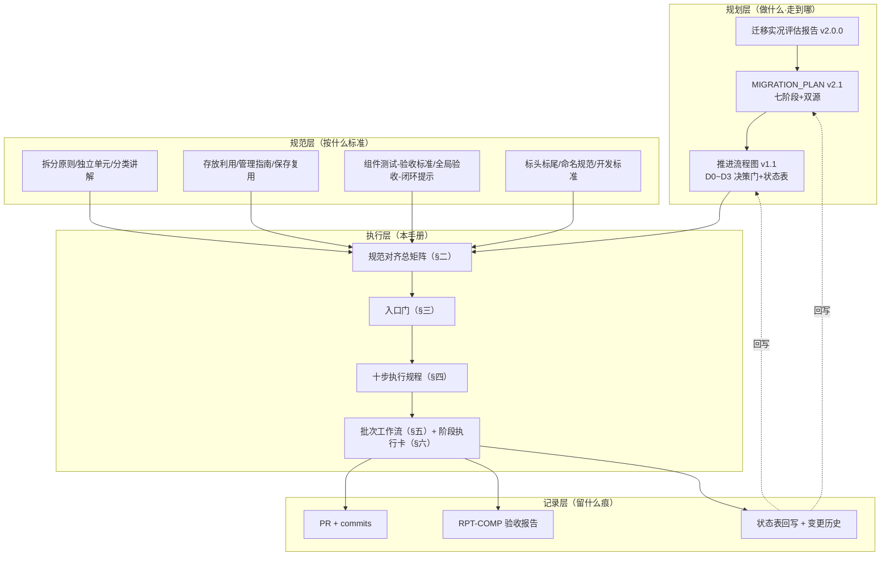

# YYC³ 组件拆分执行衔接手册 — 规范对齐 · 执行规程 · 验收放行

> **_YYC³_**（YanYuCloudCube™ · 注册商标）
> _言启象限 | 语枢未来_
> **_Words Initiate Quadrants, Language Serves as Core for Future_**
> _万象归元于云枢 | 深栈智启新纪元_
> **_All things converge in cloud pivot; Deep stacks ignite a new era of intelligence_**

---

## 一、文档定位与衔接关系

本手册是 YYC³ 组件库拆分迁移的**执行规程层**：向上衔接规划三件套，向下对齐 docs/ 规范体系，把「做什么」（计划）与「按什么标准」（规范）装配为「怎么一步步做、做到什么数字算通过」（规程）。



**使用顺序**：先查 §三入口门是否放行 → 按 §四/§五执行 → 按 §七度量放行 → 按 §八回写。规范冲突时，以被引用规范原文为准；本手册只做装配，不新造标准。

---

## 二、规范对齐总矩阵（强制条款数字化）

| # | 执行环节 | 引用规范 | 强制条款（数字化/可判定的） |
| --- | --- | --- | --- |
| 1 | 组件识别与分类 | 《YYC3-项目组件-拆分原则》《YYC3-项目组件-分类讲解》 | 三大原则逐条过；五层体系（原子→分子→有机体→模板→页面）+ 决策树定层；四步完善流程（识别命名→属性定义→变体设计→文档生成）不跳步 |
| 2 | 独立性/可复用性判定 | 《YYC3-拆分组件-独立单元》 | 独立性 5 项检查（无全局状态/无外部上下文/自包含/可独立测试/Props 传递依赖）**评分 ≥ 0.8** 方可入库；可复用性 5 项（多变体/场景无关/有文档/循规范/使用 ≥2 处）**评分 ≥ 0.6** 方标「可复用」；全局状态依赖组件**禁止入库**，先重构为 Props 依赖 |
| 3 | 存放与包结构 | 《YYC3-拆分组件-存放利用》 | Monorepo（pnpm workspace + Turborepo）；包名 `@yyc3/<name>`；包内 `src/{components,hooks,utils,types}/index.ts`；UI 包 React 走 peerDependencies |
| 4 | 跨包依赖 | 《YYC3-拆分组件-管理指南》 | 工作空间引用一律 `workspace:*`；循环依赖零容忍（`pnpm build --dry-run` 必须通过）；新依赖用 `pnpm --filter <pkg> add` |
| 5 | 版本与发布 | 《存放利用》《管理指南》《组件保存-复用指南》《全链路教科书》 | SemVer（破坏 MAJOR/新增 MINOR/修正 PATCH）；changesets 流程（changeset→version→publish）；发布前四查：测试绿/类型绿/文档全/安全过 |
| 6 | Git 与 PR | 《管理指南》+ 仓库铁律 | 分支 `feat|fix|docs|refactor|test|chore/<scope>`；commit `<type>(<scope>): <subject>`；**一切变更分支 + PR，禁直推 main**；PR 描述用《管理指南》模板（变更说明/类型/测试/检查清单） |
| 7 | 代码标头标尾 | 《YYC3-团队通用-标头标尾》v1.1.0 | 新建源码文件加 JS/TS 标准版代码标头（YYC³ 牌照块）；文件/目录/包名 ASCII `YYC3`，正文品牌 `YYC³`；代码标尾 End of File |
| 8 | 文档命名与标头 | 《YYC3-团队通用-命名规范》《标头标尾》 | 文档名按命名规范模板；front-matter 13 字段；tags 流式 `[a, b, c]`；变更历史表 + 居中标尾各一 |
| 9 | 组件测试 | 《YYC3-组件测试-验收标准》v2.1.0 | P0 必测场景 **CS-001~CS-010** 全覆盖（渲染/Props/空数据/加载/错误/点击/表单/禁用/键盘/ARIA）；覆盖率门槛：**原子 >98% / 分子 >93% / 有机体 >90% / 模板 >88% / 页面 >85%**；无障碍合规 >98%（axe-core 零 Critical/Serious）；工具链 Vitest + RTL + userEvent + jsdom |
| 10 | 功能模块拆解方向 | 《YYC3-功能拆解-多元化独立开发》 | 「先分层，再独立」；抽取出路对照十大方向（UI 组件包/Hooks 包/插件/MCP/Server Action/路由中间件/设计 Token/CLI/测试套件/微前端）择一落位 |
| 11 | 批次与终验 | 《YYC3-全局验收-闭环提示》 | 每批过组件测试验收（第 4 阶段）并出 RPT-COMP 报告；Phase 7 终验走 13 阶段流水线；遵守结论分级与放行规则、禁止行为清单 |
| 12 | 迁移源纪律 | 《迁移实况评估报告》v2.0.0 G9 + 《MIGRATION_PLAN》v2.1 §2.3 | 源一律**绝对路径 + 副本身份**；源A 主库项必须过 D0 权威副本映射表；剔除清单（node_modules/上游快照/Mcp-Edge/GitHub-API/初始化组件库冗余）永不入分母 |

---

## 三、执行入口门（Entry Gate）

任一未放行，对应动作禁止启动：

| 门 | 放行条件 | 拦截对象 |
| --- | --- | --- |
| E1 冻结线 | Phase 1 质量门 Q1 通过（`pnpm build && pnpm test` 全绿） | 一切新增搬运（Phase 3 起） |
| E2 映射表 | Phase 2 产出《权威副本映射表 v1.0》发布于 docs/ | 源A（主库十池）任何抽取 |
| E3 源校验 | PR 描述含源的绝对路径 + 副本身份（+主库项映射表行号） | 每一个抽取 PR |
| E4 域归属 | 目标域包已存在且非空壳（business/effects/icons 需先过 Phase 7 去留裁决） | 落位到空壳包的迁移 |

---

## 四、单组件拆分执行规程（十步）

> 流程图 v1.1 §三 SOP 的操作级细化。每步标注规范依据；「通过标准」是进入下一步的硬条件。

| 步 | 操作 | 规范依据 | 通过标准 |
| --- | --- | --- | --- |
| 1 | **源确认**：绝对路径 + 副本身份；主库项查映射表（D0），其余副本仅作 diff | 矩阵#12 | PR 描述可追溯到唯一权威副本 |
| 2 | **识别与分类**：按决策树定五层之一；判定独立性/可复用性并评分 | 矩阵#1/#2 | 独立性 ≥0.8；不达标先重构（Props 化）或判业务组件不强求复用 |
| 3 | **属性与变体设计**：必需/可选 props、默认值、类型；视觉/状态/功能变体 | 拆分原则·四步流程 2~3 | Props 表落档于组件文档 |
| 4 | **代码落位**：入目标域包 `src/components/<kebab-case>/`；包命名 `@yyc3/*`；跨包引用 `workspace:*`；文件头加代码标头 | 矩阵#3/#4/#7 | 目录结构与《存放利用》模板一致；`pnpm build --dry-run` 无循环依赖 |
| 5 | **清洗去重**：剔除 `.js/.d.ts/.map/node_modules`；与既有同名件 diff 过 D1（补入/跳过/择优，理由留档） | 评估报告剔除清单 | diff 清单表落档；仓库无构建产物混入 |
| 6 | **测试**：写 `__tests__/<Comp>.test.tsx`，P0 场景 CS-001~010 全过；axe 零违规 | 矩阵#9 | 本组件用例绿；不拉低包级覆盖率门槛 |
| 7 | **Story**：`stories/<域>/<Comp>.stories.tsx`，autodocs + 变体/尺寸/禁用/加载示例 | 《存放利用》Storybook 模板 | Storybook 可渲染全部变体 |
| 8 | **文档**：组件文档（特性/Props 表/示例/最佳实践）入包 README 或 docs/components/；front-matter 合规 | 矩阵#8 + 《存放利用》文档模板 | 标规校验通过（§七校验命令） |
| 9 | **构建验证**：`pnpm build && pnpm test && pnpm lint && pnpm typecheck` | 《管理指南》发布前检查 | 四查全绿 |
| 10 | **PR 与回写**：分支 + 规范 commit；PR 模板齐；回写状态表/包 README/变更历史 | 矩阵#6 + §八回写矩阵 | PR 合入且 §八全绿 |

**失败回路**：步 2 不达标 → 重构或降级为业务组件；步 5 发现分叉 → D1 择优并记 diff 清单；步 6/9 红 → 修复后重跑，禁止跳过或注释掉断言。

---

## 五、批次（Rolling Batch）工作流

一批 = 从一个权威副本抽取的一组同域组件（建议 ≤ 20 个组件/批）。


- **commit 序列**：`feat(<域>): 抽取 <项目> <N> 组件` → `test(<域>): 补 CS-001~010` → `docs(<域>): 组件文档与状态回写`（docs 与代码同 PR）。
- **验收报告**：编号 `RPT-COMP-{YYYYMMDD}-{SEQ}`，模板取自《组件测试-验收标准》§输出报告模板，归档至 `docs/YYC3-项目验收-闭环体系/reports/`。
- **changeset**：新组件 minor、修复 patch；不与未过验收的批次混合。

---

## 六、阶段执行卡

| 阶段 | 执行要点 | 验收门 | 主要规范 |
| --- | --- | --- | --- |
| Phase 0 治理收尾 | main 分支保护；Mimosa 完整扫描补跑 | 保护规则回执 + 扫描结论落档 | 仓库铁律 |
| Phase 1 存量固化 | install/build 修红；test 基线 + 11 域补冒烟；README 15 域；包级 README 标来源；stories 遗留清理 | **Q1：build+test 全绿**（E1 放行条件） | 矩阵#9 |
| Phase 2 主库普查 | 十池副本矩阵（419 行）；权威副本映射表 v1.0；UI-8 专项评估；NM/剔除过滤器入库 scripts/ | 映射表发布（E2 放行条件） | 评估报告 §五 |
| Phase 3 Claw UI+设计文档 | S1 十五件按 §四执行（theme-tokens → theme）；S5 六篇文档迁移加标头标尾 | 双主题 Storybook 演示 + 标规校验 | 矩阵#7/#8 |
| Phase 4 shadcn 去重 | S2 ×56 逐件 diff；D1 三分支处置 | 56 行 diff 清单全覆盖 | 矩阵#2 |
| Phase 5 web-ui+core | D2 裁决（推荐 a：core → packages/core）；S3 15 源文件清洗迁入；5 hooks 单测 | D2 决策留档 + build 绿 | 矩阵#4 |
| Phase 6 归档裁决 | D3：karbon vs layouts 功能比对 | 裁决结论入变更历史 | 独立单元判定 |
| Phase 7 落地发包 | apps/storybook 门户 + playground；templates；changesets 演练；空壳三包去留；13 阶段终验 | 《全局验收-闭环提示》执行通过 | 矩阵#5/#11 |
| 滚动抽取（源A） | 按 §五批次工作流；首批建议 UI-8 `yyc3-reusable-components` + `YYC3-UI-Design-System` | 每批 RPT-COMP 报告 | 全部矩阵 |

---

## 七、度量与放行

### 7.1 分级验收（取自《组件测试-验收标准》）

| 级 | 含义 | 关键数字 | 不满足后果 |
| --- | --- | --- | --- |
| 🔴 P0 | 阻断 | 原子覆盖 >98%、分子/有机体 >90%、交互通过 >99%、无障碍 >98%、Error Boundary 全覆盖关键组件、表单 100% 键盘可操作 | **禁止合入/发布** |
| 🟡 P1 | 警告 | 模板/页面覆盖 >85%、快照 100%、样式回归、响应式、主题切换 | 降质量评级 |
| 🟢 P2 | 优化 | 视觉回归自动化、i18n、动画、渲染性能、Story 交互 | 提升至优秀 |

### 7.2 每批放行 = §四十步全绿 + P0 全过 + RPT-COMP 报告归档；Phase 7 放行 = 13 阶段流水线执行 + 结论分级达「准予发布」。

### 7.3 标规合规快检（每批 docs 变更后执行）

```bash
# front-matter 完整性（无输出的文件为缺失）
grep -L "^file: " docs/YYC3-项目组件-拆分规范/*.md
# 居中标尾唯一性（每篇应 = 1）
grep -c '<p align="center">' <变更的文档>
# 品牌写法残留（应为空）
grep -rn "YanYuCloudCube-" docs/
```

### 7.4 禁止行为（对齐《全局验收-闭环提示》与仓库铁律）

直推 main；跳过 D0/D1 用非权威副本；注释/删除失败断言凑绿；构建产物入库；口头决策不留档；「做了不记」（变更不回写状态表与变更历史）。

---

## 八、追溯与回写矩阵

| 动作 | 必须回写 | 规则 |
| --- | --- | --- |
| 组件合入 | `MIGRATION_PLAN.md` §1.1 状态表 | 唯一进度事实源，同 PR 内回写 |
| 阶段完成 | 《推进流程图》§五状态总览表 | 进度条 + 完成标志 |
| 包内容变化 | 包 README + CHANGELOG（changesets 生成） | 《存放利用》文档结构 |
| 文档修改 | 该文档变更历史表 + front-matter `version`/`updated` | SemVer：修正 PATCH / 新增 MINOR / 重组 MAJOR |
| 批次验收 | RPT-COMP 报告归档 | `docs/YYC3-项目验收-闭环体系/reports/` |
| 决策门裁决（D0~D3） | PR 描述 + 对应计划/流程图变更历史 | 禁止口头决策 |

---

## 九、附录：单组件执行卡（复制使用）

```markdown
### 执行卡：<组件名>（<域包>）
- 源：绝对路径 + 副本身份（主库项：映射表行 #__）
- 分类：原子/分子/有机体/模板/页面（决策树路径：__）
- 独立性评分：__/5（不达标项与处置：__）
- 可复用性评分：__/5（业务组件可标 N/A）
- Props 表：必需 __ / 可选 __ / 默认值 __
- 变体：视觉 __ / 状态 __ / 功能 __
- 测试：CS-001~010 ☐；axe ☐；包覆盖率影响：__
- Story：变体 __ / 尺寸 __ / 禁用 ☐ / 加载 ☐
- D1 结果：补入 / 跳过 / 择优（理由：__）
- 四查：build ☐ test ☐ lint ☐ typecheck ☐
- 回写：状态表 ☐ 包 README ☐ 变更历史 ☐
```

---

## 变更历史

| 版本 | 日期 | 变更内容 | 作者 |
| ---- | ---- | -------- | ---- |
| v1.0.0 | 2026-11-03 | 首次发布：规范对齐总矩阵（12 环节数字化强制条款）、四道执行入口门、单组件十步执行规程、批次工作流、阶段执行卡、分级放行与回写矩阵 | YYC³ Team |

---

<p align="center">
  <b>YYC³</b>（YanYuCloudCube™ · 注册商标）<br>
  言启象限 | 语枢未来<br>
  <i>Words Initiate Quadrants, Language Serves as Core for Future</i><br>
  万象归元于云枢 | 深栈智启新纪元<br>
  <i>All things converge in cloud pivot; Deep stacks ignite a new era of intelligence</i><br>
  <sub>© 2026 YanYuCloudCube™（YYC³）· <a href="mailto:admin@0379.email">admin@0379.email</a></sub>
</p>
