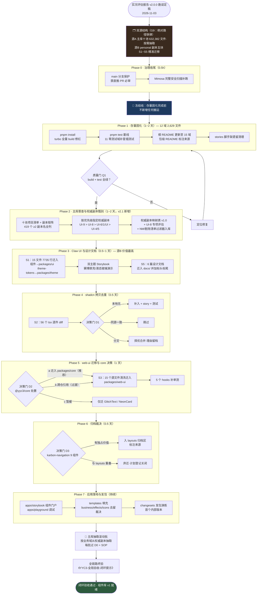
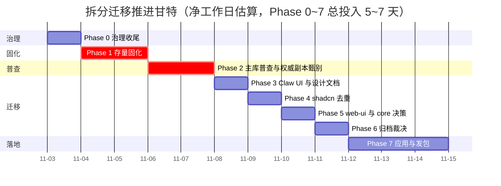
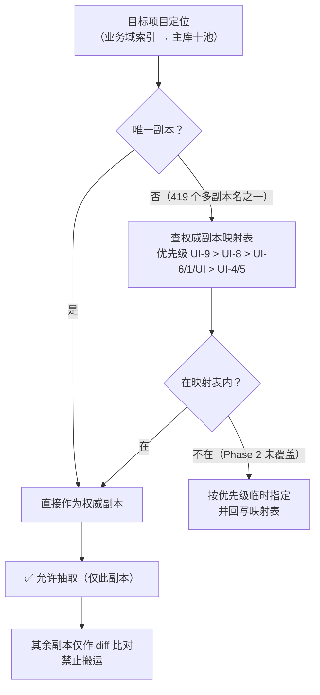
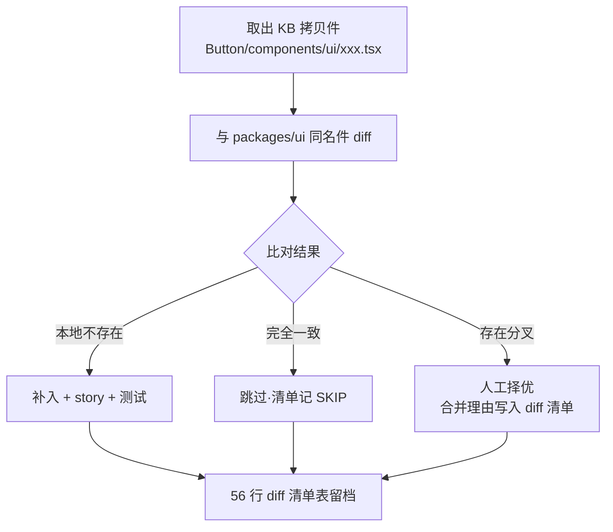
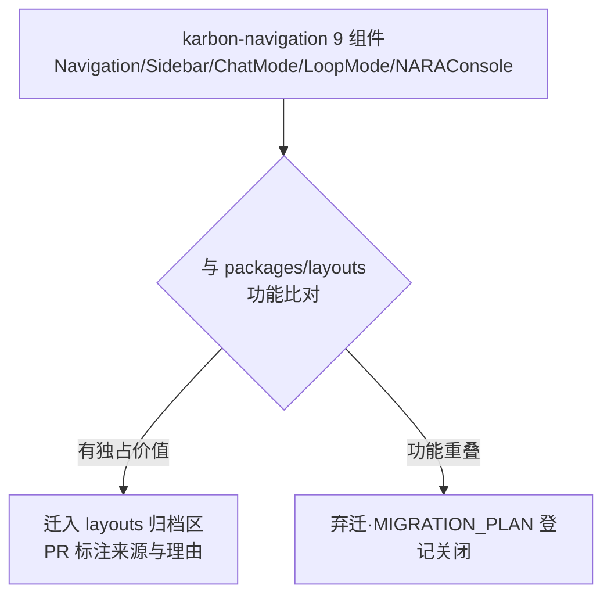

# YYC³ 组件拆分推进流程图 — 总览流程 · 阶段子图 · 决策门 · 单组件 SOP

> **_YYC³_**（YanYuCloudCube™ · 注册商标）
> _言启象限 | 语枢未来_
> **_Words Initiate Quadrants, Language Serves as Core for Future_**
> _万象归元于云枢 | 深栈智启新纪元_
> **_All things converge in cloud pivot; Deep stacks ignite a new era of intelligence_**

---

## 一、总览流程图

依据《YYC3-组件库-迁移实况评估报告 v2.0.0》（2026-11-03 勘误版）与《MIGRATION_PLAN.md v2.1》绘制。**铁律前置**：迁移源 = **双源结构**（源 A 主库 `/Users/yanyu/YYC3-Knowledge-Base/YYC3-UI{,-1..-9}` 十池按需抽取 + 源 B `/Users/yanyu/YYC-Cube/personal/YYC3-Knowledge-Base/YYC3-UI-用户界面/` 五块精准素材）；主库组件级抽取永不整迁；主库项必须过 D0 权威副本校验；Phase 1 完成前冻结新增搬运。

**方法论挂钩**：Phase 3~6 的每一批迁移，拆分粒度遵循《YYC3-项目组件-拆分原则》三原则与《YYC3-拆分组件-独立单元》判定；存放与版本遵循《YYC3-拆分组件-存放利用》与《YYC3-拆分组件-管理指南》；验收口径见《YYC3-项目验收-闭环体系》各分册。

---

## 二、推进甘特图

---

## 三、单组件迁移 SOP 微流程（每批必走，随 PR 勾选）

对应《MIGRATION_PLAN.md v2.1》§四检查清单，任何一批组件迁移都按此微流程执行：

---

## 四、决策门详解

### D0｜权威副本校验（Phase 2 产出，此后一切主库抽取的强制前置）

**Phase 2 产出物**：副本矩阵（419 行）、权威副本映射表 v1.0、UI-8 组件库工作区专项评估（YYC3-UI-Design-System 5,616 文件 / yyc3-monorepo / yyc3-reusable-components 463 / 组件拆分规范 5 篇）、NM 与剔除清单过滤器（scripts/）。

### D1｜shadcn 组件去重判定（Phase 4，逐件 ×56）

### D2｜@yyc3/core 依赖处置（Phase 5 前置）

| 方案 | 内容 | 适用 | 推荐 |
| --- | --- | --- | --- |
| a | core 真身（personal 副本 `YYC3-B/core`）迁入本仓 `packages/core` | 长期自主可控，组件库自洽 | ✅ 推荐 |
| b | pnpm workspace 跨仓引用 | 短期过渡，持续耦合知识库 | 过渡可用 |
| c | web-ui 整体暂缓，仅迁无依赖的 GlitchText / NeonCard | core 体量或归属未定时 | 保底 |

### D3｜karbon-navigation 归档裁决（Phase 6）

---

## 五、状态总览表（随阶段 PR 回写，唯一细粒度视图）

| 阶段 | 内容 | 状态 | 进度 | 完成标志 |
| --- | --- | --- | --- | --- |
| 前置 | 实况评估报告（v1.0.0 → **v2.0.0 勘误**） | ✅ 完成 | `██████████` 100% | 双副本定性 + 十池画像 + 419 副本矩阵 |
| 前置 | MIGRATION_PLAN（v2.0.0 → **v2.1.0**） | ✅ 完成 | `██████████` 100% | 双源结构 + 七阶段 |
| Phase 0 | 治理收尾（分支保护 + 安全扫描） | ✅ 完成 | `██████████` 100% | 保护规则 ✅；Mimosa 38 findings 分诊归档（真钥 1 经确认属废弃项目已关闭并改环境变量注入，见计划 §五A） |
| Phase 1 | 存量固化（12 域构建测试文档） | ✅ 完成* | `█████████░` 90% | build ✅ 全绿；test 364✅/50❌（8 文件债在册绑定批次，Q1 门修订见计划 §五A）；README 15 域 ✅ |
| Phase 2 | **主库普查与权威副本甄别（新增）** | ✅ 完成 | `██████████` 100% | 权威副本映射表 v1.0（482 行）+ 过滤器入库 ✅ |
| Phase 3 | Claw UI + 设计文档迁移（源B S1/S5） | ⏳ 待开始 | `░░░░░░░░░░` 0% | 双主题 story 演示 |
| Phase 4 | shadcn 拷贝去重（源B S2） | ⏳ 待开始 | `░░░░░░░░░░` 0% | 56 行 diff 清单留档 |
| Phase 5 | web-ui + core 决策（源B S3） | ⏳ 待开始 | `░░░░░░░░░░` 0% | D2 裁决 + hooks 单测 |
| Phase 6 | 归档裁决（源B S4） | ⏳ 待开始 | `░░░░░░░░░░` 0% | D3 结论留档 |
| Phase 7 | 应用落地与发包 | ⏳ 待开始 | `░░░░░░░░░░` 0% | changesets 演练成功 |
| 滚动 | 主库抽取批次（源A，过 D0 + SOP） | 🔄 首批已入 | `██░░░░░░░░` 20% | 批次 1：@yyc3/lib v0.1.0 ✅（UI-8 utils，18 测试）；批次 2 候选：hooks/types/error-handling |
| 终验 | 全链路闭环验收 | ⏳ 待开始 | `░░░░░░░░░░` 0% | 闭环提示词执行通过 |

---

## 六、使用说明

1. **执行顺序刚性**：Phase 1 质量门 Q1 未过不得搬运（冻结线）；Phase 2 映射表未发布，主库（源 A）抽取不得开始；
2. **双源分工**：源 B（personal 五块）走 Phase 3~6 精准迁移；源 A（主库十池）走 D0 + SOP 滚动抽取；
3. **决策留痕**：D0/D1/D2/D3 每次裁决必须落档，禁止口头决策；
4. **回写责任**：每阶段 PR 最后一步回写本文件 §五状态表与 `MIGRATION_PLAN.md` §1.1 状态表；
5. **本文档与计划的关系**：`MIGRATION_PLAN.md` 管「做什么与验收」，本流程图管「怎么走与走到哪」，冲突时以计划为准并即时同步本图；
6. **操作级规程**：SOP 微流程的逐步细化、强制条款数字化与放行标准见《YYC3-组件拆分-执行衔接手册》（§四十步规程 = 本图 §三 SOP 的操作级展开）。

---

## 变更历史

| 版本 | 日期 | 变更内容 | 作者 |
| ---- | ---- | -------- | ---- |
| v1.0.0 | 2026-11-03 | 首次发布：总览流程图 + 甘特图 + 单组件 SOP 微流程 + 三大决策门 + 状态总览表（六阶段版） | YYC³ Team |
| v1.1.0 | 2026-11-03 | 勘误修订：总览图改双源结构（源A 主库十池/源B personal 五块）；新增 Phase 2 普查甄别与决策门 D0 权威副本校验；原 Phase 2~6 顺延为 3~7；SOP 第 1 步改绝对路径+D0 校验；状态表加滚动抽取行 | YYC³ Team |
| v1.1.1 | 2026-11-03 | §六挂接《YYC3-组件拆分-执行衔接手册》为 SOP 操作级规程 | YYC³ Team |
| v1.1.2 | 2026-11-04 | 状态表回写：Phase 0/1/2 完成（Phase 1 按 Q1 修订门 90%）；测试债登记簿随计划 §五A；滚动抽取解冻待首批 | YYC³ Team |
| v1.1.3 | 2026-11-04 | Phase 0 行更新：Supabase 真钥确认属废弃项目，风险关闭 | YYC³ Team |

---

  <b>YYC³</b>（YanYuCloudCube™ · 注册商标） 
  言启象限 | 语枢未来 
  <i>Words Initiate Quadrants, Language Serves as Core for Future</i> 
  万象归元于云枢 | 深栈智启新纪元 
  <i>All things converge in cloud pivot; Deep stacks ignite a new era of intelligence</i> 
  © 2026 YanYuCloudCube™（YYC³）· <a href="mailto:admin@0379.email">admin@0379.email</a>

